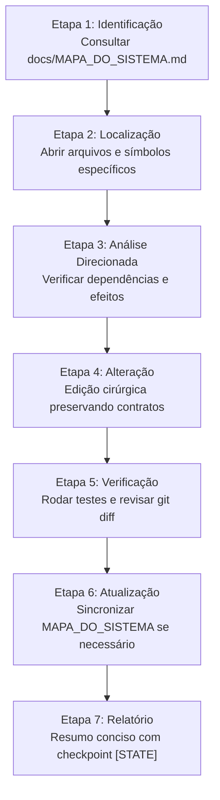

# AGENTS.md — Protocolo Universal de Governança de IA & Economia Extrema de Tokens
**Framework Coringa & Framework Universal v4.0-Universal | Droma**

> [!IMPORTANT]
> **REGRA DE OURO INVIOLÁVEL (MAP-FIRST):** Sempre antes de realizar qualquer manutenção ou alteração no projeto, consulte obrigatoriamente o arquivo [`docs/MAPA_DO_SISTEMA.md`](docs/MAPA_DO_SISTEMA.md) para identificar com exatidão onde e o que alterar, sem fazer varreduras cegas e sem reler todas as páginas da aplicação.

---

# PROTOCOLO UNIVERSAL DE GOVERNANÇA DE AGENTES & ECONOMIA EXTREMA DE TOKENS

## 1. AUTONOMIA OPERACIONAL DIRETA (DISPENSA DE CONFIRMAÇÃO)
- Execute diretamente TODAS as etapas, comandos e edições locais sem pedir confirmações intermediárias.
- Só interrompa por: (1) ambiguidade crítica de requisitos, (2) ação destrutiva irreversível, (3) violação de regra inviolável.

## 2. NAVEGAÇÃO MAP-FIRST MANDATÓRIA (ZERO ALUCINAÇÃO)
- Antes de rodar comandos, ler código ou editar, você DEVE consultar o mapa arquitetural do projeto ([`docs/MAPA_DO_SISTEMA.md`](docs/MAPA_DO_SISTEMA.md)).
- Acesso restrito aos arquivos mapeados necessários. Proibida exploração cega no disco. Retorne e atualize o mapa ao concluir.

## 3. PROTOCOLO DE ECONOMIA EXTREMA DE TOKENS
- **LEITURA FATIADA (LINE-SLICING):** Proibido ler arquivos inteiros. Use `read_file` com `StartLine` e `EndLine` fatiados sob demanda.
- **EDIÇÃO CIRÚRGICA (`edit_file`):** Proibido reescrever arquivos inteiros (`write_file`). Substitua cirurgicamente com 1 a 3 linhas de ancoragem.
- **ZERO SLOP:** Elimine 100% de saudações ("Certamente!", "Aqui está"), introduções e conclusões. Comece no 1º caractere técnico útil.
- **FORMATO COMPACTO [STATE]:** Checkpoints em texto plano condensado (≤ 15 linhas), dispensando JSONs prolixos.
- **CONTENÇÃO DE LOGS:** Testes e buscas com filtros específicos. Nunca despeje logs massivos no contexto.
- **PROIBIÇÃO DE RELEITURA:** Nunca releia arquivos já inspecionados na sessão ativa.
- **ACHADOS FORA DE ESCOPO:** Registre melhorias acessórias em 1 linha sem tocar no código (`achados_fora_de_escopo`).

## 4. METODOLOGIA SDD & RISEN
- Spec antes do código. Divida tarefas em fases numeradas (Prompt Chaining) com entregáveis verificáveis.
- **Fail-Fast:** Se uma tentativa falhar 2 vezes, PARE. Não entre em loop exploratório. Reporte o bloqueio com precisão.

---

## 2. Os 6 Pilares Universais de Alta Performance para Respostas de IA

1. **Autonomia Operacional Direta (Zero-Pause Execution):** A IA recebe a meta e executa sequencialmente até a entrega, pausando somente por ambiguidade crítica, ação destrutiva irreversível ou conflito explícito com regras mestras.
2. **Protocolo Map-First (Navegação Espacial Estruturada):** Consulta mandatória a [`docs/MAPA_DO_SISTEMA.md`](docs/MAPA_DO_SISTEMA.md) antes de tocar em qualquer arquivo. Elimina 100% das alucinações de caminhos de arquivos.
3. **Especificação Prévia SDD & RISEN:** Requisitos e contratos definidos antes do código via framework RISEN (Role, Instructions, Steps, Expectation, Narrowing).
4. **Decomposição Faseada & Regra Fail-Fast:** Tarefas divididas em 3 a 7 etapas verificáveis. Se falhar 2 vezes na mesma abordagem, interrompe e emite alerta com a causa raiz.
5. **Raciocínio Nativo Oculto (Native Thinking / Hidden CoT):** Deduções, testes teóricos e cálculos internalizados no canal de raciocínio. A resposta visível deve ser limpa, cirúrgica e executável.
6. **Semáforo Concorrente Multi-Agente (Handoff Protocol):** Uso do arquivo [`HANDOFF.md`](HANDOFF.md) para controle de reservas de arquivos quando houver múltiplos agentes ou terminais operando em paralelo.

---

## 3. Mecanismos Universais de Economia Extrema de Tokens

| Mecanismo Universal | Vício Operacional Comum | Diretriz Obrigatória do Framework | Economia Medida |
| :--- | :--- | :--- | :--- |
| **1. Leitura Fatiada (Line-Slicing)** | Ler arquivos inteiros de 500+ linhas (`read_file`). | Uso estrito de `StartLine` e `EndLine` para inspecionar unicamente as linhas necessárias. | -75% a -92% tokens de input |
| **2. Edição Cirúrgica (`edit_file`)** | Reescrever o arquivo inteiro com `write_file`. | Substituição atômica via `edit_file` com 1 a 3 linhas de ancoragem. | -90% a -97% tokens de output |
| **3. Saída Zero-Slop** | Saudações cordiais, desculpas e adulações. | Início direto no 1º caractere técnico útil. Clareza objetiva com links clicáveis. | -20% a -35% tokens resposta |
| **4. Formato Compacto (`[STATE]`)** | Checkpoints estruturados em JSON prolixo. | Formato plano `[STATE]` (≤ 15 linhas) contendo apenas campos acionáveis. | -65% por checkpoint |
| **5. Contenção de Logs & Comandos** | Testes gerais ou buscas sem filtros no chat. | Comandos com escopo específico (alvo unitário, limites `head -n 20`). | Previne exaustão de contexto |
| **6. Memória de Sessão (Anti-Releitura)** | Reabrir arquivos inspecionados há poucos turnos. | Proibição estrita de releitura de arquivos já mantidos no contexto ativo. | Zero queima redundante |
| **7. Registro Fora de Escopo** | Refatorar arquivos vizinhos por impulso. | Anotação concisa em 1 linha em `achados_fora_de_escopo` sem mexer no arquivo. | Mantém prompt limpo e estável |

### Padrão Universal do Checkpoint Compacto [STATE] (≤ 15 Linhas)

```text
[STATE]
fase: <numero> | status: <concluida | parcial | bloqueada>
objetivo: <1 frase clara do entregavel executado>
decisoes: <decisao tecnica adotada — motivo sucinto>
arquivos_tocados: <caminho/do/arquivo:Lxx-Lyy resumo da alteracao em 1 linha>
mapa_atualizado: <sim | nao>
achados_fora_de_escopo: <nota: caminho:Lxx descricao em 1 linha | nenhum>
falhas: <o que falhou (tentativas: n) | nenhuma>
prox_passo: <1 frase clara da proxima acao imediata>
```

---

## 4. Checklist Inviolável de Governança para a IA

> **Mandamento de Conclusão:** Todo agente de IA deve obrigatoriamente validar a conformidade dos 7 pontos abaixo antes de emitir a mensagem final ou finalizar a tarefa. Caso qualquer item falhe, o status do checkpoint deve ser obrigatoriamente marcado como "parcial" ou "bloqueada" — nunca "concluida":

- [ ] **MAP-FIRST OBRIGATÓRIO:** O mapa arquitetural do projeto foi consultado antes de qualquer intervenção?
- [ ] **NAVEGAÇÃO RESTRITA:** Apenas os arquivos estritamente mapeados e necessários foram abertos e analisados?
- [ ] **MODIFICAÇÃO CIRÚRGICA:** Foi utilizado estritamente `edit_file` com ancoragem mínima, sem `write_file` integral?
- [ ] **LEITURA FATIADA:** O carregamento de código foi feito via faixas de linhas (line-slicing), sem leituras cegas massivas?
- [ ] **RETORNO E ATUALIZAÇÃO DO MAPA:** O mapa arquitetural foi atualizado com novos arquivos ou responsabilidades antes do fim?
- [ ] **ZERO-SLOP RIGOROSO:** A resposta ao usuário foi iniciada no 1º caractere útil, eliminando saudações e conclusões prolixas?
- [ ] **CHECKPOINT COMPACTO:** O estado final foi estruturado no formato plano `[STATE]` (≤ 15 linhas)?

---

## 5. Regras Obrigatórias e Invioláveis do Projeto Droma

1. **Reutilizar Código e Padrões Existentes:** Aproveite componentes, helpers e bibliotecas já implementados no projeto (ex: métodos de [`src/Security.php`](src/Security.php), [`config/database.php`](config/database.php)).
2. **Modificar Somente o Necessário:** Altere pontualmente apenas as linhas e blocos essenciais para satisfazer o pedido.
3. **Evitar Duplicação:** Não crie novos utilitários, funções de sanitização, formatadores de data/moeda ou clientes HTTP se já existirem no projeto.
4. **Preservar Interfaces e Contratos:** Mantenha assinaturas de métodos, retornos, códigos HTTP, campos de formulário e regras de negócio preexistentes intactos.
5. **Respeitar a Arquitetura do Projeto:** Siga o modelo estabelecido (PHP 8.3/8.4 moderno, Vanilla JavaScript sem build complexo, CSS com variáveis no design system Droma, PDO com prepared statements e transações).
6. **Não Forçar Refatorações Desnecessárias:** Não migre código procedural estável para frameworks externos (Laravel, React, Node.js), não reestruture pastas sem solicitação expressa do usuário e não troque dependências.
7. **Edições Cirúrgicas:** Jamais substitua arquivos inteiros quando uma edição pontual for suficiente.
8. **Respeitar Estruturas Externas:** Não modifique schemas de banco de dados, variáveis de ambiente de produção, APIs públicas ou permissões sem justificativa técnica clara e aprovação.
9. **Não Sacrificar Segurança:** Nunca remova verificações de CSRF (`Security::validateCsrf`), isolamento multi-tenant (`WHERE user_id = ?`), sanitização XSS (`htmlspecialchars`) ou rate limit para simplificar uma tarefa.
10. **Honestidade Técnica Mandatória:** Nunca afirmar que testes ou comandos foram executados se não o foram.

---

## 6. Fluxo Obrigatório de Manutenção (7 Etapas)



---

## 7. Informações Rápidas do Ambiente Droma

- **Linguagem:** PHP 8.3 / 8.5 (compatível com PDO, tipagem estrita e match expressions).
- **Banco de Dados:** MySQL 8.0+ / MariaDB 10.5+ / TiDB Cloud.
- **Servidor Local:** Laragon em `C:\laragon\www\Wert`.
- **Servidor de Produção:** Render Web Service (`seu-app.onrender.com`).
- **Segredos & Chaves:** Carregados de variáveis de ambiente (`getenv()`), `.env` local ou `C:\laragon\segredos\wert.env`.
- **Validação de Sintaxe Rápida:** `php -l <arquivo.php>`.
- **Manual Integral de Governança:** [`docs/MANUAL_GOVERNANCA_IA_E_ECONOMIA_TOKENS.md`](docs/MANUAL_GOVERNANCA_IA_E_ECONOMIA_TOKENS.md) e [`docs/MANUAL_GOVERNANCA_IA_E_ECONOMIA_TOKENS.pdf`](docs/MANUAL_GOVERNANCA_IA_E_ECONOMIA_TOKENS.pdf).
