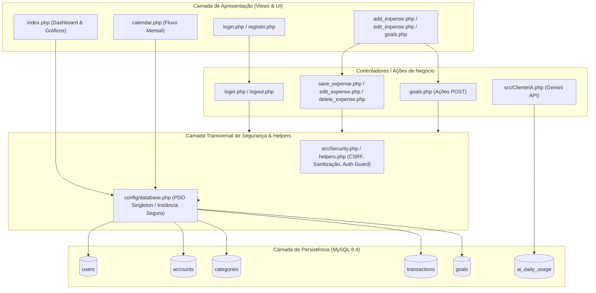

# Arquitetura e Decisões Técnicas — Projeto Wert

**Documento:** Arquitetura do Sistema e Diretrizes de Engenharia  
**Metodologia:** Spec-Driven Development (SDD) — Etapa C  
**Status:** Baseline Aprovado  

---

## 1. Princípios Arquiteturais e Diretriz de Evolução

Em conformidade estrita com a metodologia SDD e as diretrizes do projeto:
1. **Reaproveitamento Máximo do Código:** O projeto existente possui uma base sólida, visual de alta qualidade e lógica de negócios funcional. Não reescrevemos o projeto do zero nem o migramos abruptamente para frameworks externos (Laravel, Symfony, React, Node.js).
2. **Evolução Gradual e Segura:** As melhorias são aplicadas de forma modular e incremental. Funções utilitárias e de segurança são introduzidas para resolver redundâncias e vulnerabilidades sem alterar a assinatura pública dos arquivos de página existentes.
3. **Segurança por Padrão (Security by Design):** Nenhuma mutação de estado é permitida sem validação de método HTTP (`POST`), verificação de autenticação de sessão, token anti-CSRF e validação estrita de integridade referencial por usuário (`user_id`).

---

## 2. Camadas da Aplicação e Organização

A arquitetura atual evolui de um modelo puramente procedural em arquivos raiz para uma estrutura progressivamente desacoplada:

---

## 3. Decisões Técnicas Centrais

### 3.1 Centralização de Segurança e Helpers (`src/Security.php` ou `config/helpers.php`)
- **Problema Identificado:** O mecanismo de token CSRF estava implementado de forma isolada em `profile.php`, enquanto `save_expense.php`, `edit_expense.php`, `delete_expense.php` e `goals.php` estavam desprotegidos. Além disso, a validação de propriedade (`account_id` e `category_id` pertencem ao usuário?) estava ausente nesses scripts.
- **Decisão:** Criar um módulo centralizado de helpers de segurança reutilizável (`src/Security.php`), fornecendo:
  - `Security::csrfToken()`: obtém ou gera o token da sessão;
  - `Security::csrfField()`: renderiza o input hidden formatado para inserção em formulários;
  - `Security::validateCsrf(?string $token)`: valida com `hash_equals()`;
  - `Security::requireAuth()`: garante que a sessão esteja ativa, redirecionando para o login se ausente;
  - `Security::validateAccountOwnership(PDO $pdo, int $accountId, int $userId)`: valida pertença da conta;
  - `Security::validateCategoryOwnership(PDO $pdo, int $categoryId, int $userId, ?string $type)`: valida pertença da categoria e coerência de tipo.
- **Justificativa:** Elimina duplicação de código, garante conformidade com o RNF-03 e RNF-04, e permite proteção imediata de todas as páginas sem quebrar a estrutura existente.

### 3.2 Correção da Vulnerabilidade de Exclusão via GET
- **Problema:** `delete_expense.php` recebia o ID por GET e executava `DELETE` diretamente no banco, tornando-o suscetível a ataques CSRF via tags HTML normais ou links compartilhados.
- **Decisão:**
  - `delete_expense.php` passará a exigir estritamente o método `POST` e o token CSRF.
  - No `index.php` e `calendar.php`, o botão "Excluir" passa a submeter um pequeno formulário inline via POST (com confirmação em JavaScript `confirm()`), mantendo exatamente o mesmo design e comportamento visual prévio.
- **Justificativa:** Conformidade obrigatória com as boas práticas de segurança web (OWASP Top 10 / CWE-352) e com a regra de proteção contra CSRF estabelecida na especificação.

### 3.3 Normalização de Schema para `accounts`
- **Problema:** `register.php` e `add_expense.php` inserem em `accounts` sem especificar `type`, o qual é `ENUM('checking','savings','cash','investment') NOT NULL` sem DEFAULT no schema MySQL.
- **Decisão:** Atualizar as consultas SQL no código PHP para informar explicitamente `'checking'` e criar uma migration incremental reversível `database/migrations/001_alter_accounts_default_type.sql` que adiciona `DEFAULT 'checking'` à coluna `type`.
- **Justificativa:** Garante compatibilidade total e previne falhas de inserção caso o MySQL opere sob modos restritivos de validação (`STRICT_TRANS_TABLES`).

### 3.4 Isolamento de Credenciais e Caminho do `.env`
- **Problema:** `src/ClienteIA.php` buscava credenciais em `C:/xampp/segredos/wert.env`, enquanto o projeto opera no Laragon em `C:/laragon/segredos/wert.env`.
- **Decisão:** Ajustar a resolução do arquivo para verificar dinamicamente a existência em `C:/laragon/segredos/wert.env`, `C:/xampp/segredos/wert.env` ou em variável de ambiente do sistema operacional, sem expor chaves no repositório.
- **Justificativa:** Corrige a falha funcional da IA e preserva a segurança de credenciais conforme o RNF-01 e as diretrizes do projeto.

---

## 4. Estratégia de Migrations do Banco de Dados

Todas as alterações no banco de dados devem ser versionadas em arquivos SQL numerados dentro de `database/migrations/`:
- Devem ser idempotentes ou acompanhadas de scripts de verificação;
- Não devem utilizar comandos destrutivos (`DROP DATABASE`, `TRUNCATE`, `DROP TABLE`);
- Devem conter bloco de aplicação (`UP`) e bloco de reversão (`DOWN`) documentado.

